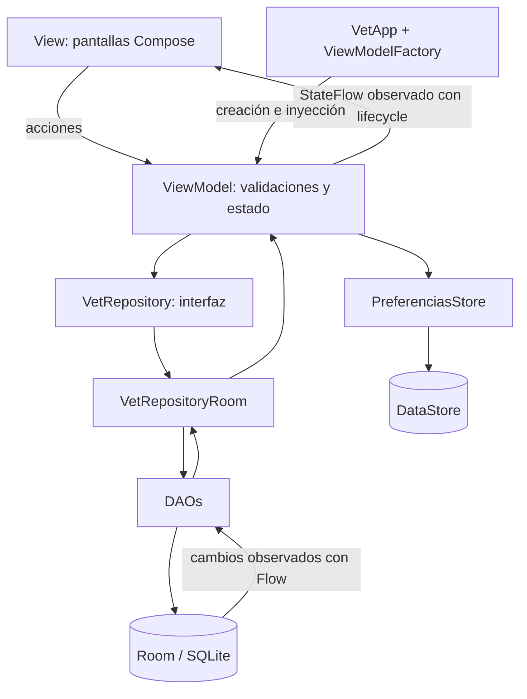
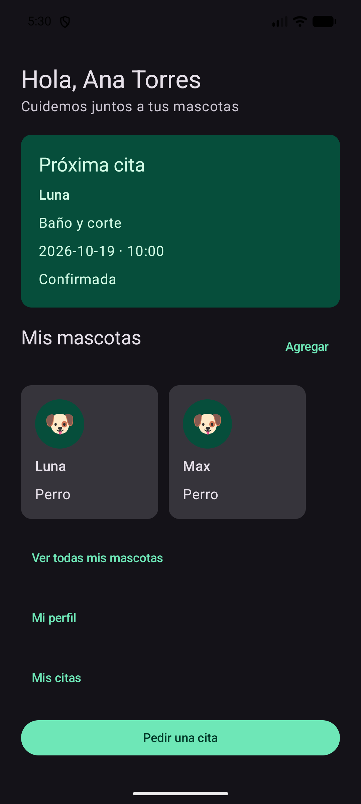
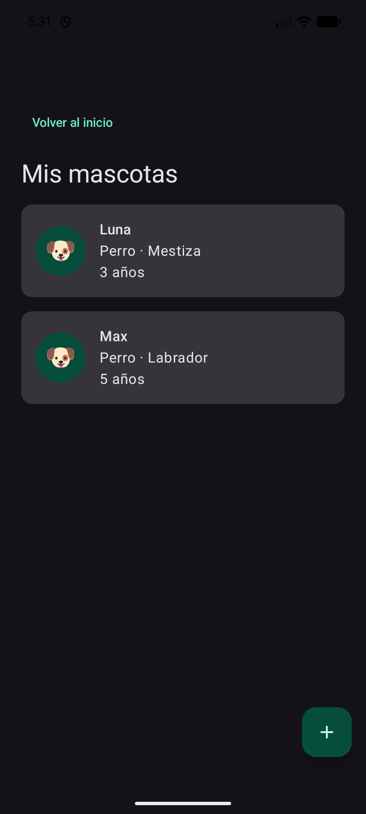
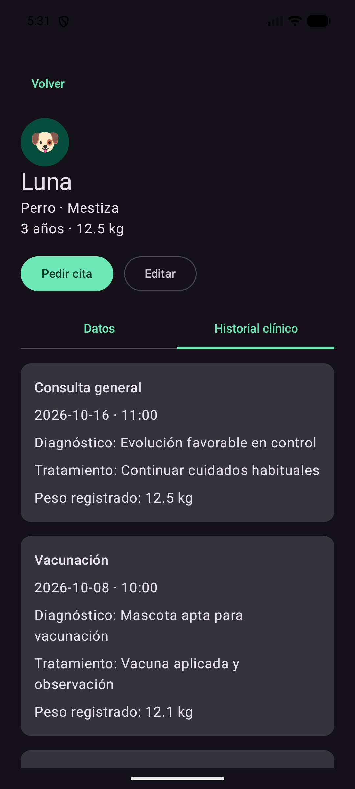
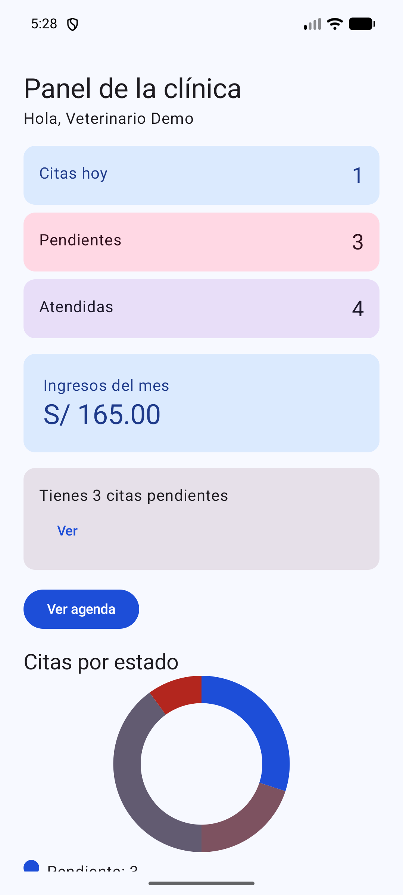
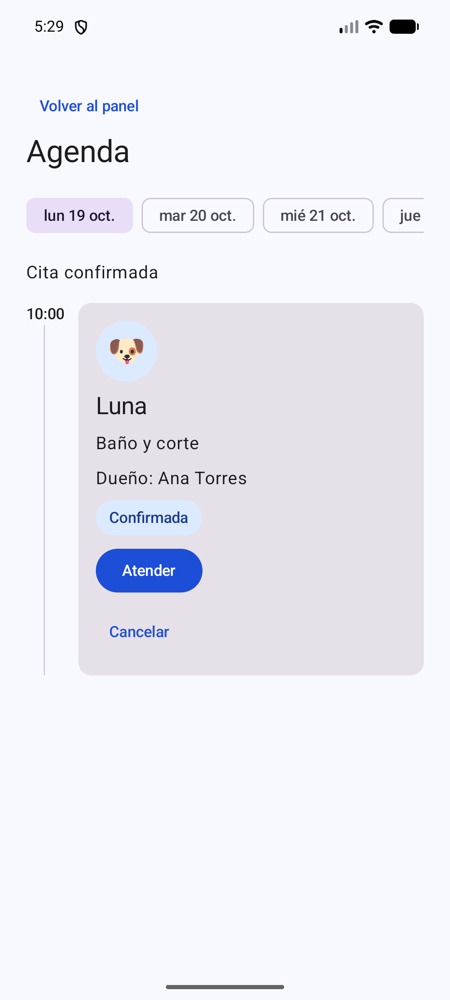
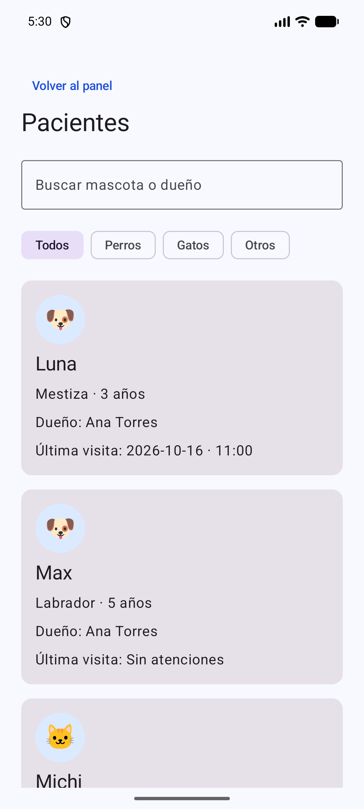

# HuellitasVet

Aplicación Android para gestionar mascotas y citas de una clínica veterinaria. El dueño registra sus mascotas, reserva citas y consulta el historial clínico. El veterinario administra la agenda, registra atenciones y controla los servicios de la clínica.

Proyecto de JContrerasC24, ubicado en `Semana 07/HuellitasVet`. Desarrollado con Kotlin, Jetpack Compose, Material 3, MVVM, Repository, Room y DataStore.

## Ejecutar el proyecto

1. Clonar el repositorio y abrir la carpeta `Semana 07/HuellitasVet` en Android Studio.
2. Esperar la sincronización de Gradle. Instalar el SDK requerido por el proyecto y seleccionar un emulador.
3. Ejecutar las comprobaciones desde la terminal de esa carpeta:

```powershell
.\gradlew.bat :app:assembleDebug :app:testDebugUnitTest
```

4. Pulsar **Run ▶** para instalar y abrir la aplicación.

Configuración actual: minSdk 26, compileSdk/targetSdk 37, Gradle Wrapper 9.5.0, AGP 9.3.3, Kotlin Compose 2.2.10, KSP 2.3.6, Room 2.7.2, Navigation Compose 2.8.2 y DataStore 1.1.1. Las versiones están en `gradle/libs.versions.toml`; el proyecto utiliza el soporte de Kotlin de AGP.

No se debe subir `local.properties`: contiene la ruta del SDK de cada equipo.

## Cuentas de demostración

| Perfil | Correo | Contraseña |
|---|---|---|
| Dueño: Ana | ana@correo.test | 1234 |
| Dueño: Luis | luis@correo.test | 1234 |
| Veterinario | vet@huellitas.test | admin |

Son datos ficticios para el laboratorio. La app funciona localmente y no utiliza un servidor. **Cambiar de perfil** alterna entre Ana y la cuenta veterinaria de demostración; no representa un sistema de autorización para producción.

La primera ejecución siembra 3 usuarios, 4 servicios, 4 mascotas y 10 citas. Las fechas se calculan respecto al día de la primera siembra y no se regeneran al abrir la app. Los cambios posteriores se conservan en Room.

## Funcionalidades

- **Dueño:** inicio con próxima cita, registro y edición de mascotas, ficha clínica, reserva por servicio y horario, próximas citas e historial, cancelación, perfil y preferencias.
- **Veterinario:** panel con contadores, ingresos y gráficos, agenda por día, confirmación y cancelación, registro de atención, búsqueda y filtros de pacientes, servicios y ajustes.
- **Persistencia:** base Room para los datos; DataStore para sesión, perfil, modo oscuro, recordatorios/notificaciones y aceptación de citas.

Los interruptores de recordatorios y notificaciones guardan la preferencia; esta versión no programa notificaciones del sistema.

## Estructura de paquetes

```text
app/src/main/java/com/contreras/huellitasvet/
├── MainActivity.kt
├── VetApp.kt
├── data/
│   ├── local/
│   │   ├── dao/           UsuarioDao, ServicioDao, MascotaDao, CitaDao
│   │   ├── entity/        Usuario, Servicio, Mascota, Cita
│   │   ├── relation/      MascotaConDueno, CitaConDetalle
│   │   ├── DatosIniciales.kt
│   │   └── VetDatabase.kt
│   ├── prefs/             PreferenciasStore
│   └── repository/        VetRepository, VetRepositoryRoom
├── model/                 Enumeraciones, horarios y reglas de negocio
├── viewmodel/             Sesion, Inicio, Mascota, PedirCita, MisCitas,
│                          Panel, Agenda, AtenderCita, Pacientes,
│                          Servicios, Preferencias y fábrica
└── ui/
    ├── components/        Campos, botones, avatares, tarjetas y estados
    │   └── graficos/      Gráfico de dona y barras con Canvas
    ├── dueno/             Pantallas del dueño
    ├── veterinario/       Pantallas del veterinario
    ├── navigation/        Rutas y NavVet
    └── theme/             Tema por perfil y modo oscuro

app/src/test/java/com/contreras/huellitasvet/
├── model/                 Pruebas de horarios y estados
└── viewmodel/             Pruebas de validaciones, filtros y próxima cita
docs/
├── PRUEBAS_ACEPTACION.md
└── capturas/              Tres capturas por perfil
```

## Diagrama MVVM



Las pantallas reciben ViewModels y callbacks de navegación. Los ViewModels dependen de la interfaz del Repository, no de los DAOs. Las operaciones críticas vuelven a comprobar las reglas dentro de una transacción para evitar cambios parciales o acciones sobre un estado desactualizado.

## Reglas principales

- El dueño consulta únicamente sus mascotas y citas.
- Una mascota requiere nombre de al menos 2 caracteres, especie y sexo, año entre 1990 y el actual, y peso positivo.
- Mascotas y servicios con citas no se eliminan. Un servicio puede desactivarse.
- Las reservas se realizan de hoy a siete días, cada 30 minutos entre 09:00 y 17:30. Los horarios pasados y ocupados se bloquean.
- El precio se copia del servicio a la cita al reservar.
- El dueño cancela únicamente citas pendientes o confirmadas cuando faltan **más de dos horas**. A las dos horas exactas no se permite.
- Una cita pasa a atendida al guardar diagnóstico, tratamiento y peso. El peso de la mascota se actualiza en la misma transacción.
- Atendida y Cancelada son estados finales.
- Si se desactiva **Aceptar citas**, se bloquea la confirmación de nuevas reservas.

## Capturas reales

Capturas del emulador Pixel 6, API 37.1, tomadas el 19 de octubre de 2026. Las pantallas del dueño muestran el modo oscuro; las del veterinario, el modo claro.

### Dueño

| Inicio y próxima cita | Mis mascotas | Historial de Luna |
|---|---|---|
|  |  |  |

### Veterinario

| Panel | Agenda y confirmación | Pacientes |
|---|---|---|
|  |  |  |

Las capturas corresponden a distintos momentos de la prueba: se confirmó una cita después de capturar el panel, por lo que el contador de pendientes se redujo de 3 a 2.

## Validación

El reporte local de `app/build/test-results/testDebugUnitTest` contiene **30 pruebas, 0 fallos, 0 errores y 0 omitidas**, incluida una prueba de plantilla. Este reporte corresponde a la ejecución realizada por el estudiante y se revisó durante el cierre.

También se instaló y abrió la app desde Android Studio. Se comprobó directamente la confirmación de una cita, su visibilidad en el perfil del dueño, el cambio de perfil, el historial de Luna y la persistencia del tema y sesión tras un cierre completo.

La inspección de una copia de la base del emulador devolvió integridad correcta, sin claves foráneas inválidas ni horarios activos duplicados. Los ingresos de octubre de 2026 sumaron **S/ 165.00**, coincidiendo con el panel.

La lista completa y el origen de cada verificación están en [Pruebas de aceptación](docs/PRUEBAS_ACEPTACION.md). Las pruebas confirmadas por el estudiante se distinguen de las observadas directamente.

## Reflexión técnica: “Para pensar”

El PDF solicita respuestas de “Para pensar”, pero el ejemplar recibido no incluye un cuestionario con ese título. Las siguientes reflexiones se basan en los temas y preguntas explicativas que sí aparecen en el documento; no se presentan como una transcripción de preguntas ausentes.

**¿Por qué guardar fecha y hora como texto?**  
El formato fijo `yyyy-MM-dd` y `HH:mm` permite ordenar y comparar los valores en SQLite. Para aplicar reglas de tiempo se convierten a `LocalDate`, `LocalTime` y `LocalDateTime`.

**¿Por qué guardar el precio en la cita?**  
Representa el precio acordado al reservar. Si se modifica el servicio, las citas existentes y los ingresos históricos conservan su importe.

**¿Cuándo usar suspend y cuándo Flow?**  
Se usa `suspend` para una operación puntual, como guardar o cancelar. Se usa `Flow` para observar datos que pueden cambiar, como la agenda. El ViewModel expone `StateFlow` para que la pantalla muestre el estado actualizado.

**¿Por qué registrar la atención en una transacción?**  
La cita debe quedar atendida y la mascota debe recibir el nuevo peso conjuntamente. Si una operación falla, la transacción evita que solo una parte quede guardada.

**¿Por qué la pantalla no accede al DAO?**  
La pantalla se encarga de mostrar datos y recibir acciones. Separar las consultas y reglas permite cambiar la interfaz sin mezclarla con la base de datos y facilita las pruebas.

**¿Qué se guarda en Room y qué en DataStore?**  
Room guarda las entidades relacionadas: usuarios, mascotas, servicios y citas. DataStore guarda preferencias pequeñas, como el tema y la sesión seleccionada.

**¿Por qué comprobar el horario y el estado de nuevo al guardar?**  
La información mostrada puede cambiar antes de que el usuario confirme. La validación final evita reservar un horario ocupado o modificar una cita que ya tiene un estado final.

**¿Qué ocurre si cambia el esquema de Room?**  
Se debe incrementar la versión y definir una migración. Borrar los datos solo es una alternativa para un entorno de prueba cuando se acepta perderlos.

## Alcance y asistencia

Este repositorio desarrolla los apartados funcionales de la fase 1. Durante su implementación y documentación se utilizó asistencia de Codex; no se presenta como trabajo realizado sin IA. La fase 2 y sus mejoras deben documentarse por separado conforme a las indicaciones del docente.
